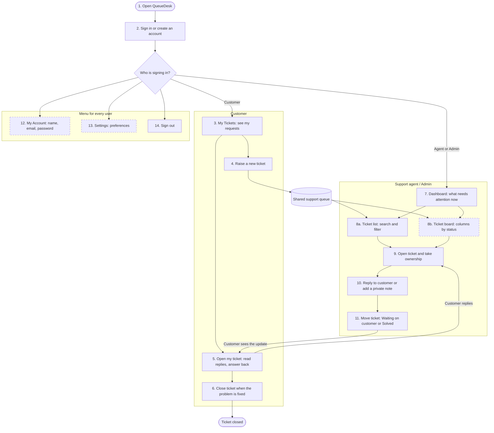
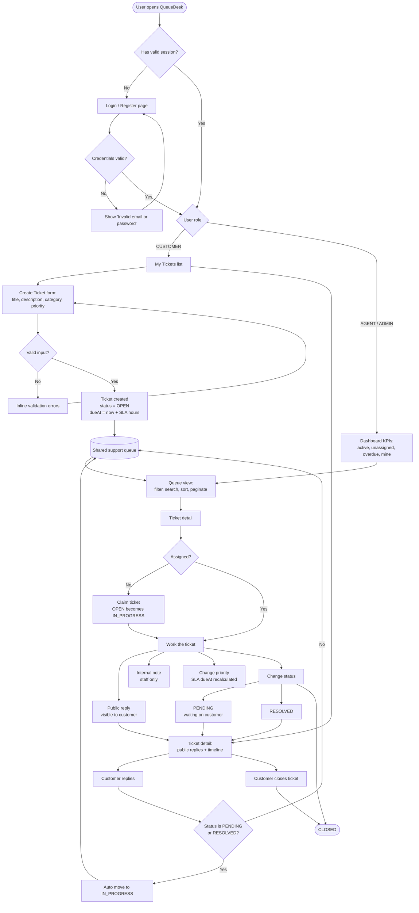
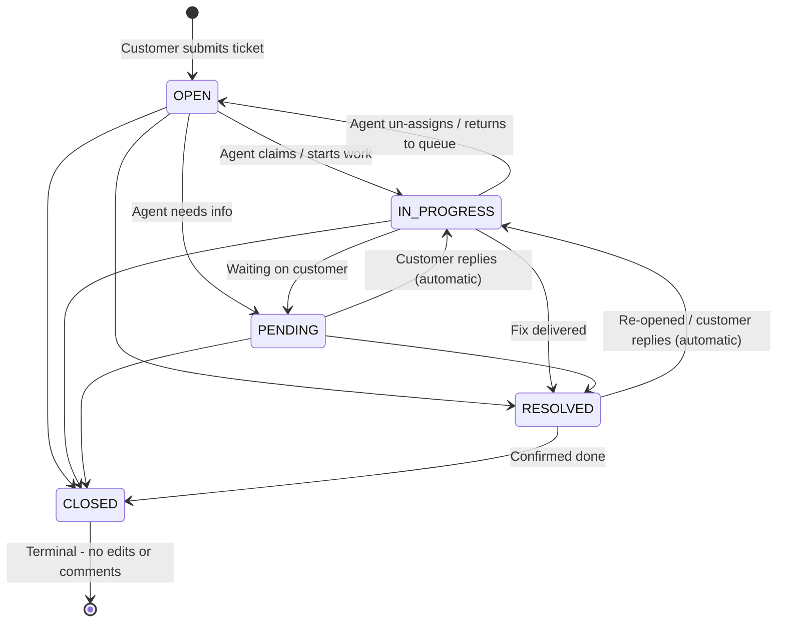
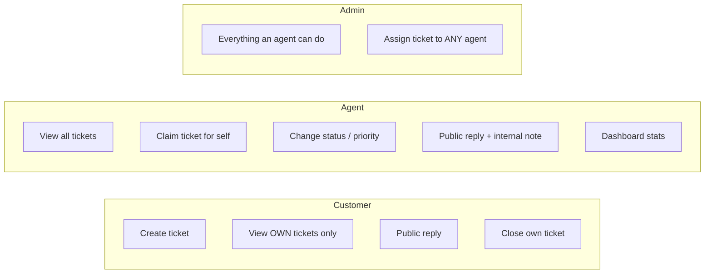
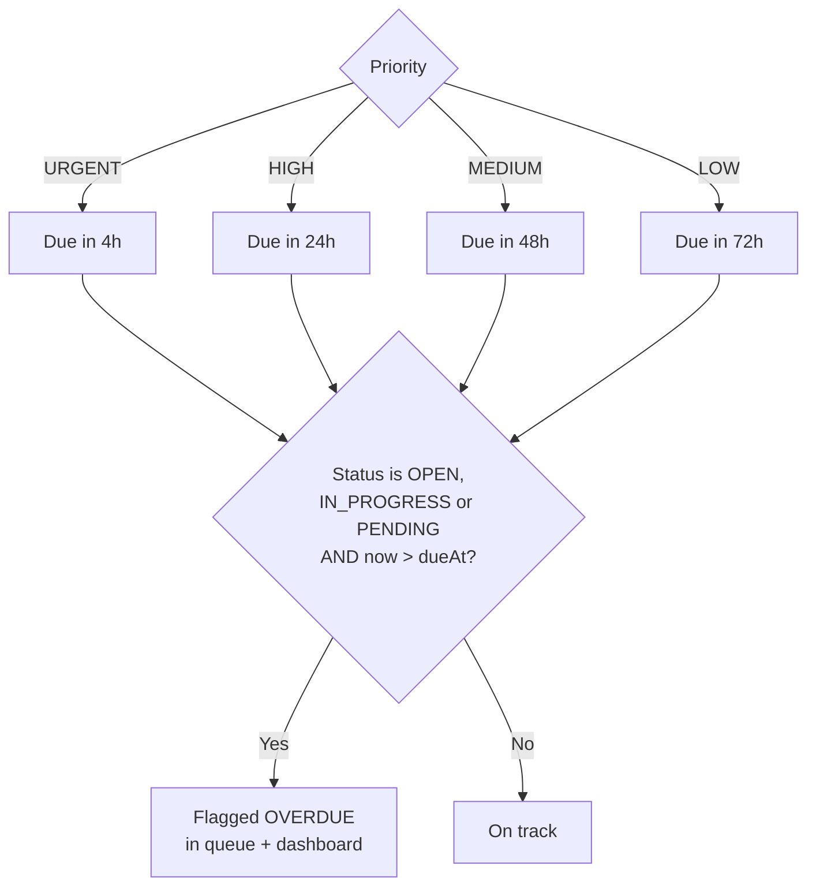
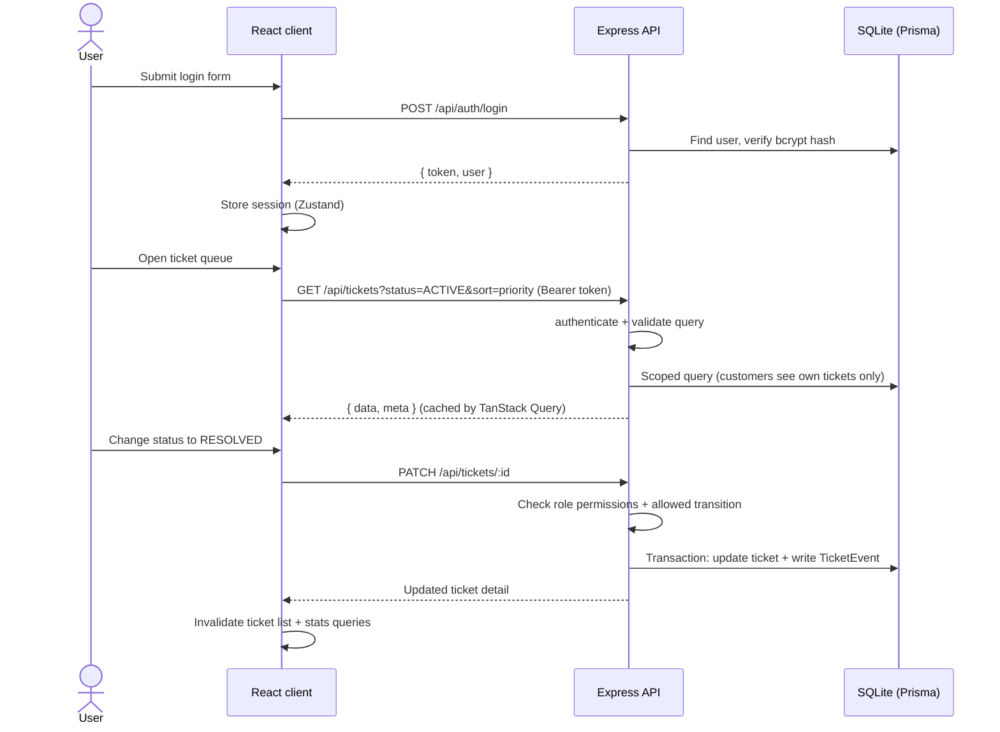

# QueueDesk — How the Ticket Support Queue Works

These diagrams describe the behaviour enforced by the API
(`server/src/domain/ticketRules.ts` and `server/src/modules/tickets/tickets.service.ts`).

## Quick overview (for business and QA)

The whole app on one page in plain language. Step numbers match the QA checklist below.
Dashed boxes are **planned** screens. They are not in the PRD or the code yet.

### QA checklist for the overview

| Step | What to check                                    | Expected result                                                                    |
| ---- | ------------------------------------------------ | ---------------------------------------------------------------------------------- |
| 2    | Sign in with a wrong password                    | "Invalid email or password". It does not say which one was wrong.                  |
| 2    | Customer signs in                                | Lands on My Tickets. Opening `/dashboard` sends them back to `/tickets`.           |
| 2    | Agent or Admin signs in                          | Lands on the Dashboard.                                                            |
| 3    | Customer views their list                        | Only their own tickets are shown.                                                  |
| 4    | Submit a ticket with missing fields              | Inline errors. Nothing is saved.                                                   |
| 4    | Submit a valid ticket                            | Status is Open, number is `#1001` or higher, due date is set by priority.          |
| 5    | Customer replies to a Waiting or Solved ticket   | Ticket goes back to In Progress.                                                   |
| 6    | Customer closes a ticket                         | Ticket becomes read-only. No more replies or edits.                                |
| 7    | Click a dashboard number                         | Opens the ticket list with the matching filter applied.                            |
| 8a   | Filter, search, sort, page, then press Back      | Filters are kept in the URL. Back restores the previous view.                      |
| 8b   | _(planned)_ Drag a card to another column        | Only allowed status moves work. Invalid moves are rejected. Same rules as step 11. |
| 9    | Claim an unassigned Open ticket                  | Agent becomes owner. Status becomes In Progress.                                   |
| 10   | Add a private note                               | Customer never sees it.                                                            |
| 11   | Change priority                                  | Due date is recalculated from when the ticket was created.                         |
| 11   | Try a move that is not allowed (see diagram 2)   | Rejected with an error. Ticket does not change.                                    |
| 12   | _(planned)_ Update name, email or password       | Changes are saved. A duplicate email is rejected. Password rules match sign-up.    |
| 13   | _(planned)_ Change a setting and reload the page | Setting is still applied.                                                          |
| 14   | Sign out, then reload                            | User is back on the sign-in page.                                                  |

## 1. End-to-end flow

## 2. Ticket status state machine

## 3. Who can do what

## 4. SLA and overdue rules

SLA is always measured from the ticket's creation time, so changing priority
recalculates `dueAt` from `createdAt`, not from the moment of the change.

## 5. Request lifecycle (client to API)

