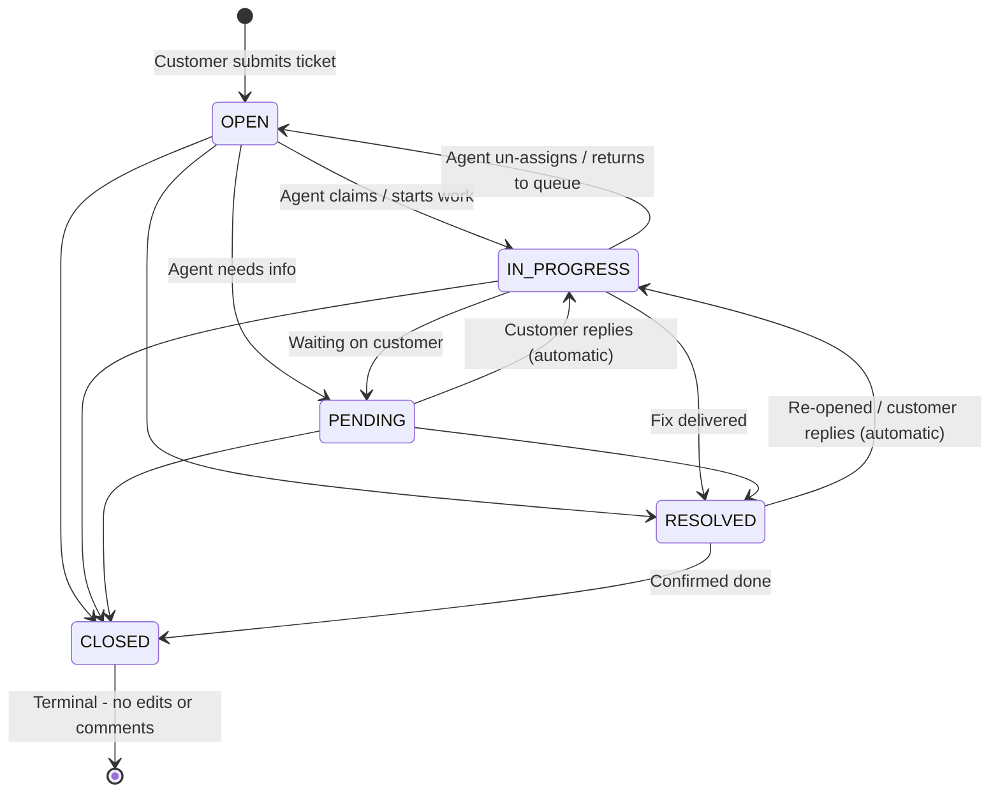
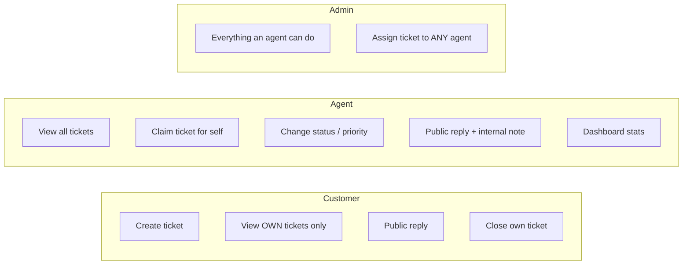
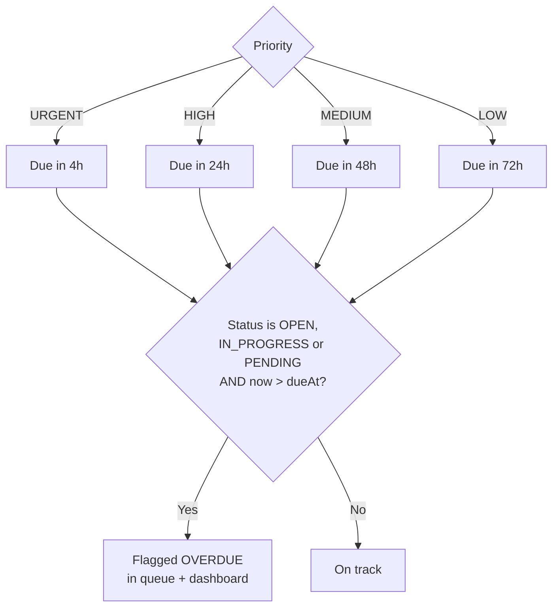
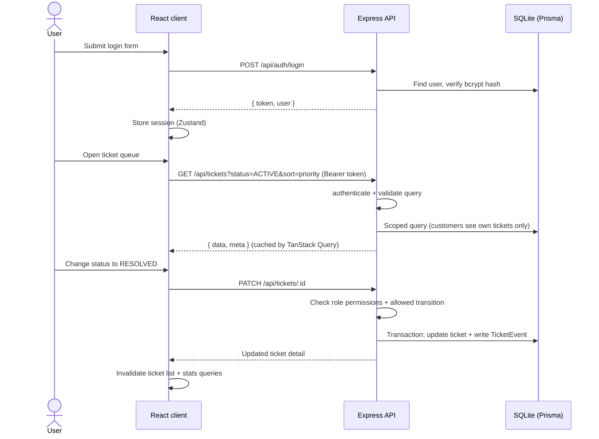

# QueueDesk — How the Ticket Support Queue Works

These diagrams describe the behaviour enforced by the API
(`server/src/domain/ticketRules.ts` and `server/src/modules/tickets/tickets.service.ts`).

## 1. End-to-end flow

## 2. Ticket status state machine

## 3. Who can do what

## 4. SLA and overdue rules

SLA is always measured from the ticket's creation time, so changing priority
recalculates `dueAt` from `createdAt`, not from the moment of the change.

## 5. Request lifecycle (client to API)

