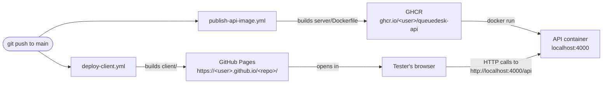

# QueueDesk — Deployment

QueueDesk ships as two pieces, each published by its own GitHub Actions workflow:

| Piece            | Workflow                                                              | Published to                     | Runs where                        |
| ---------------- | --------------------------------------------------------------------- | -------------------------------- | --------------------------------- |
| Website (client) | [`deploy-client.yml`](../.github/workflows/deploy-client.yml)         | GitHub Pages                     | Online, in the tester's browser   |
| API (server)     | [`publish-api-image.yml`](../.github/workflows/publish-api-image.yml) | GitHub Container Registry (GHCR) | On the tester's computer (Docker) |



The website is static files only. All data lives in the API container on the tester's own machine,
so every tester gets their own private copy of the demo data.

---

## 1. Website → GitHub Pages (`deploy-client.yml`)

### When it runs

- On every push to `main` that changes `client/**`, `package-lock.json` or the workflow file.
- By hand: **Actions** tab → **Deploy client to GitHub Pages** → **Run workflow**.

Pushes that only change the server or docs don't redeploy the website.

### What it does

It has two jobs, `build` and then `deploy`:

1. **Checkout** the repo.
2. **Set up Node 22** with the npm cache, so later runs install faster.
3. **Install** with `npm ci -w client --ignore-scripts`. This installs only the client's packages.
   `--ignore-scripts` skips the root `postinstall`, which would set up the server database, and the
   website doesn't need that.
4. **Build** with `npm run build -w client` (type check, then Vite build). Two build-time settings
   go in:

   | Variable       | Value                                                        | Why                                                                                        |
   | -------------- | ------------------------------------------------------------ | ------------------------------------------------------------------------------------------ |
   | `VITE_BASE`    | `/<repo-name>/`                                              | Pages serves project sites from a sub-path, so every asset URL and route needs this prefix |
   | `VITE_API_URL` | repo variable `VITE_API_URL`, or `http://localhost:4000/api` | Where the website sends API calls. There's no dev proxy on Pages, so it must be absolute   |

5. **Copy `index.html` to `404.html`.** Pages has no single-page-app routing. Without this,
   refreshing `/<repo>/tickets/123` would show GitHub's 404 page. With it, Pages serves the app and
   React Router shows the right screen.
6. **Upload** `client/dist` as the Pages artifact.
7. **Deploy** (second job) publishes the artifact. The job summary shows the live URL.

`concurrency: pages` means a newer push cancels an older deploy that's still running, so the latest
commit always wins.

### Where the code reads these settings

- [`client/vite.config.ts`](../client/vite.config.ts): `base: process.env.VITE_BASE || '/'`
- [`client/src/app/App.tsx`](../client/src/app/App.tsx): the router `basename` comes from
  `import.meta.env.BASE_URL`
- [`client/src/lib/apiClient.ts`](../client/src/lib/apiClient.ts):
  `baseURL = import.meta.env.VITE_API_URL || '/api'`

Locally neither variable is set, so `npm run dev` still serves from `/` and proxies `/api` to
port 4000.

### One-time setup

1. Push the repo to GitHub.
2. **Settings → Pages → Build and deployment → Source:** choose **GitHub Actions**.
3. Push to `main`, or run the workflow by hand.

### Pointing the website at a different API

By default the website calls the tester's `localhost:4000`. To use an API hosted somewhere else:

1. **Settings → Secrets and variables → Actions → Variables → New repository variable**
2. Name it `VITE_API_URL`, with a value such as `https://api.example.com/api`.
3. Re-run the workflow. The URL is baked in at build time, so changing it always needs a rebuild.

---

## 2. API → Docker image on GHCR (`publish-api-image.yml`)

### When it runs

- On every push to `main` that changes `server/**`, `package.json`, `package-lock.json`,
  `.dockerignore` or the workflow file.
- On every pushed tag that starts with `v` (for example `v1.0.0`).
- By hand: **Actions** tab → **Publish API image to GHCR** → **Run workflow**.

### What it does

1. **Checkout** the repo.
2. **Set up QEMU and Buildx.** QEMU emulates ARM so one runner can build images for both
   `linux/amd64` (Windows and Intel machines) and `linux/arm64` (Apple Silicon Macs). Docker picks
   the right one automatically on `docker pull`.
3. **Log in to `ghcr.io`** with the built-in `GITHUB_TOKEN`. You don't need to create a secret. The
   `packages: write` permission at the top of the file allows the push.
4. **Work out tags and labels** (`docker/metadata-action`). It also adds an
   `org.opencontainers.image.source` label, which links the package to the repo on GitHub.
5. **Build and push** [`server/Dockerfile`](../server/Dockerfile) with the repo root as build
   context (the npm lockfile lives there). Build layers are cached in GitHub Actions (`type=gha`),
   so runs that don't change dependencies are much faster.

### Image tags

| Trigger        | Tags produced                       | Example                          |
| -------------- | ----------------------------------- | -------------------------------- |
| Push to `main` | `latest`, `sha-<short>`             | `:latest`, `:sha-3704873`        |
| Tag `v1.2.0`   | `1.2.0`, `1.2`, `sha-<short>`       | `:1.2.0`, `:1.2`, `:sha-9f1c2ab` |
| Manual run     | `latest` (on `main`), `sha-<short>` |                                  |

Testers normally use `:latest`. Pin `:1.2.0` or `:sha-...` when you need everyone on the exact same
build.

To cut a release:

```bash
git tag v1.0.0
git push origin v1.0.0
```

### What's inside the image

From [`server/Dockerfile`](../server/Dockerfile):

- Base is `node:22-bookworm-slim` with OpenSSL, which Prisma needs.
- The **build stage** installs the server's packages, generates the Prisma client and compiles
  TypeScript to `dist/`.
- The **runtime stage** runs as the non-root `node` user. The SQLite database is at
  `/data/queuedesk.db`, so mount a volume on `/data` to keep data.
- **On every start** it applies migrations, runs the seed, then starts the API. Both steps are
  safe to repeat: existing data is kept, and demo data is only added to an empty database.
- A **health check** calls `/api/health` every 10 seconds, so `docker ps` shows `(healthy)`.

### One-time setup

GHCR makes new packages **private**, so testers get `denied` until you change that:

1. Let the workflow run once.
2. Go to your GitHub profile → **Packages** → `queuedesk-api` → **Package settings**.
3. **Danger Zone → Change visibility → Public.**

### Settings you can override at `docker run`

| Variable         | Default           | Notes                                                                    |
| ---------------- | ----------------- | ------------------------------------------------------------------------ |
| `CORS_ORIGIN`    | `*` (any website) | Websites allowed to call the API: a comma-separated list, or `*` for any |
| `JWT_SECRET`     | dev value         | Change it for anything beyond local testing                              |
| `JWT_EXPIRES_IN` | `8h`              | How long a login lasts                                                   |

Example that only allows your Pages site:

```bash
docker run -d --name queuedesk-api -p 4000:4000 -v queuedesk-data:/data \
  -e CORS_ORIGIN=https://<github-user>.github.io \
  ghcr.io/<github-user>/queuedesk-api:latest
```

---

## 3. How the website reaches the API on localhost

The website is served over HTTPS from `github.io`, and it calls `http://localhost:4000`. Two things
make that work:

- **Browsers treat `localhost` as secure**, so Chrome, Edge and Firefox allow an HTTPS page to call
  `http://localhost`. Safari doesn't, which is why the README tells testers not to use it.
- **CORS and private network access.** The API in
  [`server/src/app.ts`](../server/src/app.ts) allows the origins in `CORS_ORIGIN`. It also answers
  Chrome's `Access-Control-Request-Private-Network` preflight with
  `Access-Control-Allow-Private-Network: true`. Newer Chrome versions also show a "local network
  access" prompt, and the tester has to click **Allow**.

Logins use a bearer token stored in the browser, not cookies. That's why allowing any origin
(`CORS_ORIGIN=*`) is acceptable for a local test server: another website can't use a tester's
session without the token.

---

## Troubleshooting

| Symptom                                                     | Likely cause and fix                                                                                                        |
| ----------------------------------------------------------- | --------------------------------------------------------------------------------------------------------------------------- |
| Pages workflow fails at **deploy** with a permissions error | Pages source isn't set to **GitHub Actions** (see §1 setup)                                                                 |
| Site loads but shows a blank page                           | Wrong `VITE_BASE`. Did the repo get renamed? Re-run the workflow                                                            |
| Refreshing a page shows GitHub's 404                        | `404.html` step missing or failed. Check the build log                                                                      |
| "Cannot reach the server" on the site                       | API container isn't running, the browser blocked the local network prompt, or `CORS_ORIGIN` doesn't match                   |
| `denied` on `docker pull`                                   | Package is still private (see §2 setup)                                                                                     |
| Image workflow fails at **push** with `403`                 | **Settings → Actions → General → Workflow permissions** must allow read and write, or the package isn't linked to this repo |
| Image workflow is slow                                      | The first run and dependency changes rebuild everything, and ARM is emulated. Later runs use the cache                      |
