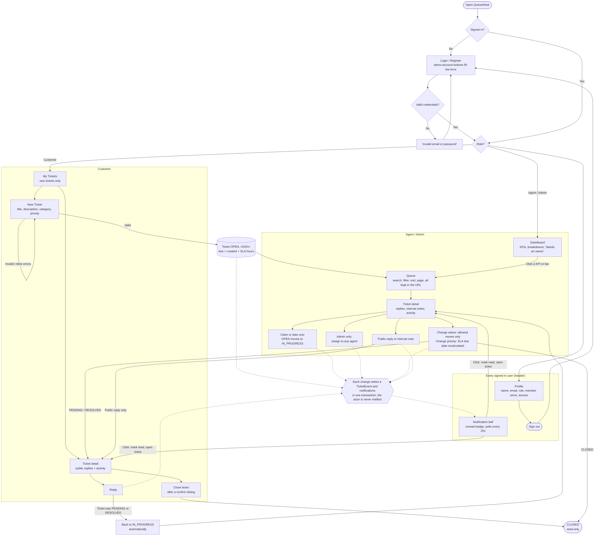

# QueueDesk — App Flow

One diagram covering every screen, role and rule in the app. The rules are enforced by the API
(`server/src/domain/ticketRules.ts`, `server/src/modules/tickets/tickets.service.ts`), and the UI
only mirrors them. See the [PRD](./PRD.md) for details.

## Rules behind the diagram

- **Status moves:** OPEN → IN_PROGRESS / PENDING / RESOLVED / CLOSED · IN_PROGRESS → OPEN / PENDING /
  RESOLVED / CLOSED · PENDING → IN_PROGRESS / RESOLVED / CLOSED · RESOLVED → IN_PROGRESS / CLOSED ·
  CLOSED is terminal. Anything else returns `422`.
- **SLA:** URGENT 4h, HIGH 24h, MEDIUM 48h, LOW 72h, always measured from creation. A ticket is
  **overdue** when it is OPEN, IN_PROGRESS or PENDING and past its due date.
- **Access:** customers only see their own tickets (others return `404`), never see internal notes,
  and can only close their own ticket. Only admins assign tickets to other agents.
- **Notifications:** new ticket → all staff · assigned → new assignee + requester · status change →
  requester + assignee · priority change → assignee · public reply → requester + assignee ·
  internal note → assignee only.

## QA checklist

| Area          | What to check                                    | Expected result                                                          |
| ------------- | ------------------------------------------------ | ------------------------------------------------------------------------ |
| Login         | Wrong password                                   | "Invalid email or password". It doesn't say which one was wrong.         |
| Login         | Customer signs in, then opens `/dashboard`       | Lands on My Tickets. `/dashboard` redirects back to `/tickets`.          |
| Login         | Agent or admin signs in                          | Lands on the Dashboard.                                                  |
| Login         | Open `/profile` while signed out, then sign in   | Sent to `/login`, then returned to `/profile`.                           |
| My Tickets    | Customer views their list                        | Only their own tickets are shown.                                        |
| New Ticket    | Submit with missing fields                       | Inline errors. Nothing is saved.                                         |
| New Ticket    | Submit a valid ticket                            | Opens the new ticket: Open, `#1001` or higher, due date set by priority. |
| Ticket detail | Customer replies to a Pending or Resolved ticket | Status goes back to In progress.                                         |
| Ticket detail | Customer closes a ticket                         | Asks to confirm. Afterwards the ticket is read-only.                     |
| Dashboard     | Click a KPI card or a breakdown bar              | Opens the queue with the matching filter applied.                        |
| Queue         | Filter, search, sort, page, then press Back      | Filters live in the URL. Back restores the previous view.                |
| Ticket detail | Agent claims an unassigned Open ticket           | Agent becomes owner. Status becomes In progress.                         |
| Ticket detail | Agent adds an internal note                      | Customer never sees it, in the thread or the bell.                       |
| Ticket detail | Change priority                                  | Due date is recalculated from when the ticket was created.               |
| Ticket detail | Admin assigns the ticket to another agent        | Assignee changes. An agent has no "assign to others" control.            |
| Bell          | Customer replies on a ticket an agent owns       | The agent's badge goes up within 20s. Clicking opens the ticket.         |
| Bell          | Click "Mark all as read"                         | Badge clears.                                                            |
| Profile       | Click the avatar in the header                   | Shows name, email, role, member since and what the role can do.          |
| Profile       | Click Sign out, then reload                      | Back on the sign-in page.                                                |
